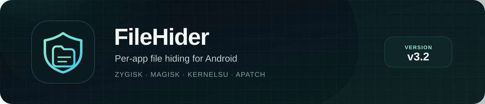
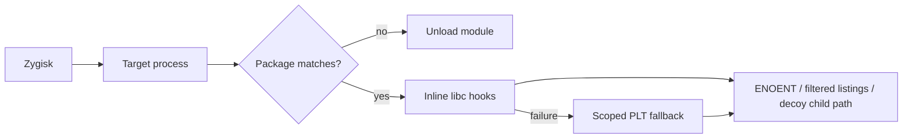

<p align="center">
  
</p>

<p align="center">
  <a href="https://github.com/yeasin0423/FileHider/actions/workflows/build.yml"></a>
  <a href="https://github.com/yeasin0423/FileHider/releases/latest"></a>
  
  
  
  <a href="LICENSE"></a>
</p>

<p align="center">
  <strong>Hide any file or folder from only the apps you choose.</strong><br>
  Per-app. Process-scoped. No global mode.
</p>

<p align="center">
  <a href="https://github.com/yeasin0423/FileHider/releases/latest"></a>
  <a href="docs/CONFIGURATION.md"></a>
  <a href="docs/TROUBLESHOOTING.md"></a>
</p>

---

FileHider is a **Zygisk** module for Magisk, KernelSU, and APatch. Pick an app,
list the absolute paths it should not see, and that app gets `ENOENT` while
every other app keeps the real filesystem.

It is built for detectors that inspect root traces, emulator files, system
libraries, `/proc` entries, or their own private files — without forcing you to
know whether the check runs in Java, native code, a directory listing, or a
shell child.

```text
com.example.detector    /system/build.prop
com.example.detector    /system/xbin
com.example.detector    /proc/cpuinfo
```

With these rules, `com.example.detector` and its `:remote` processes see those
paths as missing. Other apps do not.

## Why FileHider

| | |
| --- | --- |
| **Per-app, not global** | A process must match a configured package. `system_server` is never hooked, and there is no wildcard mode. |
| **App-agnostic inside the app** | Java/`libcore`, native libraries, `stat`/`open`/`access`, listings, and literal shell paths are covered. |
| **Invisible, not just blocked** | Hidden paths return `ENOENT`, directory entries disappear from `getdents64`/`readdir`, and literal child paths become a missing decoy. |
| **All common ABIs** | `arm64-v8a`, `armeabi-v7a`, `x86_64`, and `x86`, with an inline engine and a scoped PLT fallback. |

## At a glance

| Property | Support |
| --- | --- |
| Android | 7.0+ (API 24) |
| Root managers | Magisk with Zygisk, KernelSU, APatch |
| Zygisk providers | Built-in, Zygisk Next, ReZygisk, NeoZygisk |
| Architecture | `arm64-v8a`, `armeabi-v7a`, `x86_64`, `x86` |
| WebUI | KernelSU and APatch |
| Config | WebUI or `/data/adb/filehider/targets.conf` |
| Hiding scope | One package plus its `:subprocesses` |
| Artifact | Flat flashable Magisk module zip |

## Quick start

1. Download the [latest release](https://github.com/yeasin0423/FileHider/releases/latest).
2. Flash `FileHider-v3.1.zip` in Magisk, KernelSU, or APatch.
3. Reboot once so Zygisk loads the module.
4. Open the module WebUI (KernelSU/APatch) or edit
   `/data/adb/filehider/targets.conf` on Magisk.
5. Enable the app, add its paths, then **Save & force-stop**.
6. Reopen the app. Check the module description and `logcat` if needed.

Rules are applied when a process starts. An app that is already running keeps
its old view until it restarts.

## Configuration

The only config file is:

```text
/data/adb/filehider/targets.conf
```

```text
# <package> <absolute path>
com.example.detector	/system/build.prop
com.example.detector	/system/xbin

# Keep this app's paths, but install no hooks for it.
!com.example.other
```

- One rule per line; whitespace separates package and path.
- `#` starts a comment.
- `!<package>` marks an app inactive while keeping its paths.
- Directory rules hide the whole subtree.
- Shared-storage aliases are expanded automatically:
  `/data/media/<user>`, `/storage/emulated/<user>`,
  `/mnt/user/<user>/primary`, `/sdcard`, and `/storage/self/primary`.

See [Configuration](docs/CONFIGURATION.md) for the WebUI, presets, browser,
inactive apps, export/import, and module-list status.

## What gets covered

| Surface | Behavior |
| --- | --- |
| `stat`, `lstat`, `fstatat`, `statx` | Hidden path returns `ENOENT`. |
| `access`, `faccessat` | Hidden path returns `ENOENT`. |
| `open`, `open64`, `openat`, `openat64` | Hidden path returns `ENOENT`. |
| `__open_2`, `__openat_2` | Fortified wrappers are hooked for native JNI callers. |
| `fopen`, `fopen64`, `opendir` | Returns `NULL` with `ENOENT`. |
| `readlink`, `readlinkat` | Hidden path is blocked. |
| `getdents64`, `readdir`, `readdir64` | Hidden entries are removed from listings. |
| `popen`, `execve`, `execv`, `execvp` | A literal hidden path in the command/argv becomes a missing decoy. |

The normal engines are ShadowHook on arm/arm64 and Dobby on x86/x86_64. If
inline installation fails, all four ABIs fall back to scoped Zygisk PLT hooks.
See [Architecture](docs/ARCHITECTURE.md) for the full process flow, engine
matrix, and unload behavior.

## How it works



The module reads the config when a target process spawns, installs hooks only
in that process, and leaves unrelated processes untouched. The first blocked
access logs `first blocked path: ...` so you can verify that runtime hiding is
active.

## WebUI

KernelSU and APatch serve the static WebUI from `module/webroot/`. It is
offline and has no build step.

- App-centric home screen with icons, labels, rule counts, and an active switch
- Per-app detail page with path input, browser, presets, and **Remove all**
- Integrity, root, emulator, native/maps, system-library, and advanced presets
- Session-cached file browser with symlink resolution
- Auto/Dark/Light themes, accent color, and icon shape
- Config export/import/reset with a `targets.conf.bak` backup
- Diagnostics with recent `FileHider` logs, a bounded WebUI activity log, and a
  safe **Clear** action

Magisk has no module WebUI; edit the config file directly.

## Install notes

- The zip is a normal Magisk/KernelSU/APatch module. It is flat at the archive
  root and contains all four ABI libraries.
- `targets.conf` is intentionally **not** in the zip. Your rules live outside
  the module directory and survive updates.
- The module description shows a boot-time status such as
  `[✅ FileHider v3.1 · active · arm64]` or
  `[❌ FileHider v3.1 · Zygisk not enabled]`.
- If the manager caches the module page, leave and reopen it after boot.

## Build from source

No Android Studio or Gradle is needed.

```bash
./scripts/bootstrap-ndk.sh   # pinned NDK r30
./scripts/test.sh            # host matcher + status tests
./scripts/build.sh           # 4 ABIs, verify, package
```

Output:

```text
dist/FileHider-v3.1.zip
```

Every build runs `scripts/verify.sh`, which checks the zip contents, all four
libraries, the exported Zygisk entry point, arm64 16 KB alignment, and the
executable bit on `service.sh`. GitHub Actions runs the same tests and build,
then uploads the zip plus `SHA256SUMS` as a workflow artifact. Releases are
created manually from that artifact.

See [Building](docs/BUILDING.md) for dependencies, overrides, and release
details, and [CHANGELOG.md](CHANGELOG.md) for release notes.

## Diagnostics

```bash
adb logcat -s FileHider        # everything
adb logcat -s FileHider:I      # matches and hook results
```

A healthy arm install includes:

```text
FileHider: inline hooks installed: 22/24
FileHider: subprocess hooks: popen=1 execve=1 execv=1 execvp=1
FileHider: first blocked path: /system/build.prop
FileHider: post /system/build.prop ... -> BLOCKED
FileHider: status working target=com.example.detector abi=arm64-v8a engine=inline
```

Read [Troubleshooting](docs/TROUBLESHOOTING.md) for the full log flow, fallback
messages, and a failure table. Use the WebUI's **Diagnostics** sheet when
reporting an issue.

## Limitations

FileHider is a libc-hook module, not a kernel or mount-namespace solution.

- Raw syscalls bypass libc hooks.
- Child processes do not inherit hooks; only literal hidden paths in
  `popen`/exec argv are rewritten.
- The PLT fallback covers selected already-loaded ELFs only.
- Translated ARM native code on x86/x86_64 may bypass host-ABI hooks.
- `/proc` metadata is not rewritten.
- A configured detector app can still introspect the resident module.
- Common storage aliases are handled; arbitrary symlinks and bind mounts need
  their exact path listed.
- Module-list status is advisory and set once at boot.

Read [Limitations](docs/LIMITATIONS.md) before using this with a detector that
performs raw syscalls or native introspection.

## Project layout

```text
.github/workflows/build.yml   CI: test, build, verify, upload
module/                        packaged Magisk module + static WebUI
zygisk/src/                    native Zygisk module and hooks
zygisk/third_party/            vendored ShadowHook and Dobby
scripts/                       bootstrap, build, test, verify, backup
tests/                         host matcher and boot-status tests
docs/                          architecture, config, build, troubleshooting
```

Detailed development rules live in [AGENTS.md](AGENTS.md).

## Credits

- [ShadowHook](https://github.com/bytedance/android-inline-hook) 2.0.1 —
  MIT, vendored for arm/arm64.
- [Dobby](https://github.com/jmpews/Dobby) — Apache-2.0, vendored for
  x86/x86_64.
- The Zygisk API header is from Magisk (GPL-3.0).

FileHider module code is MIT licensed. See [LICENSE](LICENSE).

## Disclaimer

Use FileHider only on devices and apps you own or are authorized to test.
Hiding files can break apps, and no userspace hook can guarantee invisibility
from every detector. This project is not affiliated with Magisk, KernelSU,
APatch, ShadowHook, or Dobby.
