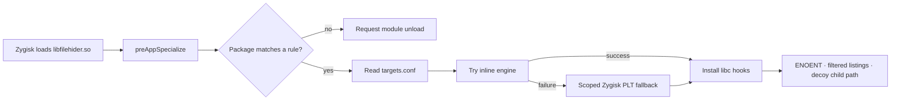

# Architecture

FileHider is a Zygisk module that installs libc hooks in selected app
processes. It is per-process and per-app by design: there is no global mode,
wildcard package, or system-wide mount.



## Process flow

1. Zygisk loads `libfilehider.so` during process specialization.
2. `main.cpp` reads `/data/adb/filehider/targets.conf` and asks the matcher
   whether the current process name matches a configured package.
3. A process with no matching rules requests `DLCLOSE_MODULE_LIBRARY` so the
   module is not resident in unrelated apps. `system_server` is always skipped.
4. A matching process installs hooks in that process only.
5. The first hidden access logs `first blocked path: ...` and the module stays
   resident because the installed hooks point into it.

The configuration is read at process spawn. Force-stop and reopen a target app
after changing its rules.

## Hook engines

| ABI | Inline engine | Fallback |
| --- | --- | --- |
| `arm64-v8a` | ShadowHook 2.0.1 on `libc.so` | Scoped Zygisk PLT hooks |
| `armeabi-v7a` | ShadowHook 2.0.1 on `libc.so` | Scoped Zygisk PLT hooks |
| `x86_64` | Dobby on `libc.so` | Scoped Zygisk PLT hooks |
| `x86` | Dobby on `libc.so` | Scoped Zygisk PLT hooks |

The inline engines patch libc itself, so they cover Java/`libcore`, app-native
libraries, and late-loaded native libraries. If the inline engine cannot patch
an entry point, the module falls back to the Zygisk PLT engine.

ShadowHook is statically linked. Its dlopen monitor is disabled with
`SH_CONFIG_NO_LINKER_MONITOR` because a static build does not ship
`libshadowhook_nothing.so`. This is safe here: only `libc.so`, which is already
loaded, is hooked.

Dobby is statically linked as `dobby_static` and is built only for the x86
ABIs. Its aliases are deduplicated so the same libc address is never patched
twice.

## Hooked entry points

```text
stat        lstat       fstatat      statx
access      faccessat
open        open64      __open_2
openat      openat64    __openat_2
fopen       fopen64
opendir
readlink    readlinkat
getdents64  readdir     readdir64
popen       execve      execv        execvp
```

`__open_2` and `__openat_2` are bionic's fortified two-argument wrappers. NDK
release builds use `_FORTIFY_SOURCE=2`, so hooking only `open`/`openat` would
miss native JNI callers.

## Hiding semantics

- A hidden path returns `ENOENT`. `fopen`/`opendir` return `NULL` with
  `ENOENT`.
- A directory rule hides the directory and its whole subtree.
- `getdents64` and `readdir` results are compacted in place, so hidden entries
  disappear from directory listings.
- Relative paths are resolved with `getcwd` or `/proc/self/fd/<n>` through the
  real `readlink` pointer. If resolution fails, the call is passed through.
- Common shared-storage names are aliased by the matcher:
  `/data/media/<user>/...`, `/storage/emulated/<user>/...`,
  `/mnt/user/<user>/primary/...`, `/sdcard/...` (user 0), and
  `/storage/self/primary/...`.
- Path matching is literal after normalization. Arbitrary symlinks, bind mounts,
  and `/proc/self/root/...` aliases need their exact path in the rules.

## Subprocess handling

Child processes do not inherit libc hooks. Instead, FileHider rewrites an
explicit hidden path in:

- `popen` command strings
- `execve` / `execv` / `execvp` paths and arguments

The replacement is a deterministic `/.filehider_missing_<hash>` path that does
not exist. Only an exact hidden path on a path boundary is replaced. A path
constructed only inside the child, a glob, a shell expansion, or a raw syscall
still bypasses this layer.

The exec hooks are **vfork-safe**: they use stack buffers, manual formatting,
and no logging or allocation. Android's `ProcessBuilder` uses `vfork`, so this
constraint is intentional.

## Scoped PLT fallback

The fallback does not scan every ELF in the process. It registers only:

- `libjavacore`, `libopenjdk`, `libart`, `libandroid_runtime`, and
  `app_process`
- app-owned ELFs under `/data/app`, `/data/data`, `/data/user`, and
  `/data/local/tmp`

It excludes `/data/adb`, `libfilehider.so`, and APK `!/` mappings. Installation
is staged, so one rejected ELF does not discard the other stages. The
`libjavacore` stage retries with a minimal symbol set if the provider rejects
the full set.

## Self-test and status

After an inline install, the module checks the first three hidden paths with
`lstat`, `access`, and `open`. Paths that were already `ENOENT` are skipped.
A visible path is reported as `still visible` and becomes a self-test failure.
PLT installs skip this test because PLT hooks cover caller ELFs, not the
module's own calls.

Diagnostic status lines include:

```text
status working target=<pkg> abi=<abi> engine=inline|plt
status failed target=<pkg> abi=<abi> reason=install|self-test
status config-missing process=<pkg>
status no-rules process=<pkg>
```

The boot-time module description is separate. It is written once by
`service.sh`; it is not driven by these status lines.

## Unload behavior

For a process with no matching rules, bad arguments, or `system_server`,
FileHider requests `DLCLOSE_MODULE_LIBRARY`. This removes the module from that
process's maps and `soinfo` scan surface.

Never request DLCLOSE after an installation attempt: a partially installed
inline hook still points into the module and would crash after unloading.

On arm/arm64, successful installations also harden executable ShadowHook maps
to `PROT_READ | PROT_EXEC` and clear their VMA names. This removes one RWX/name
signature; it is not a claim that the module is invisible to a detector running
inside a configured app.

## Packaging

The flashable zip is flat:

```text
module.prop
customize.sh
post-fs-data.sh
service.sh
uninstall.sh
webroot/...
zygisk/arm64-v8a.so
zygisk/armeabi-v7a.so
zygisk/x86_64.so
zygisk/x86.so
```

`targets.conf`, `config.example.conf`, and `module.prop.bak` are never shipped.
The persistent config is `/data/adb/filehider/targets.conf`.

All four libraries are built with 16 KB maximum page size alignment. This is
required for Android 15+ arm64 devices and harmless on the other ABIs.
